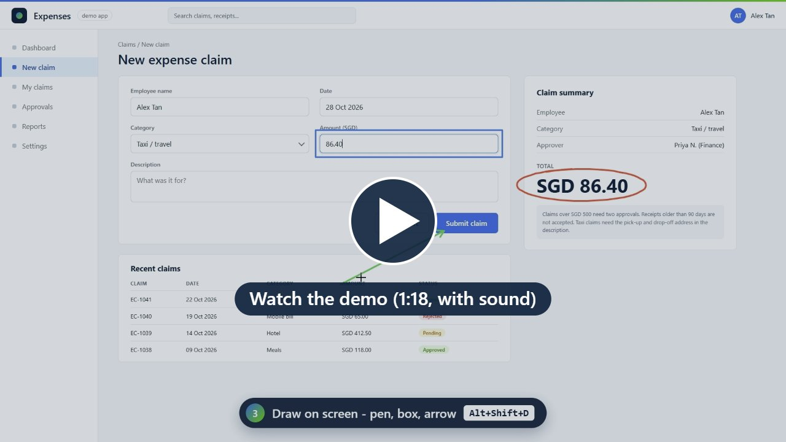

# FocusRec

A small, portable screen recorder for Windows. No install: download one `.exe` and run it.

Built for quick how-to videos and demos. You can zoom in on what matters, show where you click, and draw on the screen while you record.

## Demo

[](https://github.com/suhailasrulsani-git/focusrec/releases/download/v0.2.0/FocusRec-demo.mp4)

A 78-second tour, recorded with FocusRec itself (click the picture to play or download the MP4).

## Features

- **Record the screen** as MP4 (H.264 + AAC), so it plays in Teams, PowerPoint, phones and on Mac
- **Zoom in / out while recording**: the video zooms in smoothly around your mouse (1.5x to 3x). Your own screen stays normal.
- **Cursor and click highlight**: a yellow circle round the mouse and a ripple on every click
- **Draw on the screen**: pen, box and arrow in 4 colours, then clear with one key
- **Audio**: microphone and PC sound, mixed into one track. PC sound is recorded as it plays (stereo, no voice filters), so music and videos sound right.
- **Pause / resume**, plus a 3-2-1 countdown
- **Screenshot guides**: press a hotkey, with or without recording. Each shot marks the mouse with a red circle and adds a caption such as "Step 3 - Microsoft Outlook" with the date and time. Every guide is saved as PNG files, one HTML page and a Word document.
- **Private panel**: a small corner panel with the REC time, zoom state and your hotkeys. Only you see it.
- **Your own hotkeys**: change any of them in the Hotkeys tab
- **Hidden from the video**: the control bar and the private panel never show up in recordings or screenshots

## Hotkeys

| Default keys | Action | Works |
|--------------|--------|-------|
| `Alt+Shift+R` | Start / stop recording | Always |
| `Alt+Shift+S` | Take screenshot | Always |
| `Alt+Shift+P` | Pause / resume | While recording |
| `Alt+Shift+Z` | Zoom in / out | While recording |
| `Alt+Shift+Up` / `Down` | Zoom more / less | While recording |
| `Alt+Shift+D` | Draw mode on / off (`Esc` also stops drawing) | While recording |
| `Alt+Shift+C` | Clear the drawing | While recording |
| `Alt+Shift+H` | Cursor highlight on / off | While recording |
| `Alt+Shift+K` | Show / hide the private panel | While recording |

To change a hotkey, open the **Hotkeys** tab, click its key box and press the new keys. `Esc` cancels and `Delete` removes the hotkey. FocusRec warns you if the keys are already used inside FocusRec, or by another app or Windows.

## Screenshot guides

- Press `Alt+Shift+S` or click **Take screenshot**. It captures the whole screen the mouse is on.
- All screenshots go into the current guide until you click **New guide**.
- A guide is a folder next to your recordings:

```
Guide_2026-10-27_22-40-01\
  Step 01 - Microsoft Outlook.png   screenshot with the caption at the bottom
  guide.html                        all steps on one page (one file to share)
  guide.docx                        the same as a Word document
  images\                           screenshots without the caption
  guide.json                        list of steps
```

- The app name comes from the window in front when you press the hotkey (Windows only for now).

## Download and run

1. Get `FocusRec-x.y.z-portable.exe` from the [Releases](../../releases) page.
2. Double-click it. The first start takes a few seconds while it unpacks.
3. Recordings are saved to `Videos\FocusRec` by default. Use **Change** to pick another folder.

Windows may show a SmartScreen warning because the app is not code-signed yet. Click **More info** and then **Run anyway**.

## Privacy

- FocusRec has no network code. Nothing is uploaded and there is no telemetry.
- It only reads mouse clicks while you are recording, to draw the click ripple. Key presses are never read; hotkeys use the normal Windows hotkey system.
- For screenshot captions it reads the name of the app in front (for example "Microsoft Outlook"). It does not read window titles or content.
- Settings are stored in `%APPDATA%\FocusRec\settings.json`.

## Build from source

You need [Node.js](https://nodejs.org) 20 or newer.

```powershell
npm install
npm start            # run in development
npm run dist:win     # build dist\FocusRec-x.y.z-portable.exe
```

## How it works

| File | What it does |
|------|--------------|
| `src/main.js` | Main process: windows, hotkeys, mouse tracking, writing the file |
| `src/control.html` / `.js` / `.css` | The control bar |
| `src/recorder.js` | Screen to canvas (where the zoom happens), audio mix, MediaRecorder |
| `src/overlay.html` / `.js` | See-through layer: cursor circle, click ripples, drawing, countdown |
| `src/panel.html` / `.js` / `.css` | Private corner panel (hidden from capture) |
| `src/hotkeys.js` | Hotkey editor in the Hotkeys tab |
| `src/shot.js` | Draws the screenshot caption strip |
| `src/guide.js` | Screenshot guide folder, HTML page and Word document |
| `src/activeapp.js` | Name of the app in front, for captions (Win32 calls through koffi) |
| `src/mp4fix.js` | Rewrites the recorded MP4 into a standard layout so every player shows the length and can seek |
| `demo/` | Makes the demo video: drives FocusRec on a made-up app page, with a recorded voice and generated music (`demo/make-demo.ps1`) |

## Roadmap

- macOS build (the code is cross-platform; it needs testing on a Mac)
- App icon and code signing

## Licence

[MIT](LICENSE)
